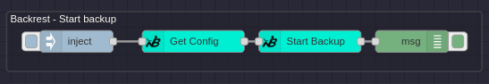

# node-red-contrib-backrest

This Node-RED module allows communication with a [Backrest](https://github.com/garethgeorge/backrest) instance, enabling seamless integration of [restic-powered](https://restic.net/) backups into Node-RED flows.

[](./examples)


If you like this module please consider donating!

[](https://ko-fi.com/B0B51BM7C)

## Features

- Start backups and get the result, with live progress and the new snapshot ID.
- Alert when a backup fails or is overdue, using the same status as the Backrest dashboard.
- React to operations (backups, forgets, prunes, restores...) as they start and finish.
- Stream the log of any operation, such as the output of a restic command.
- Call any Backrest API endpoint: manage repositories and plans, list snapshots and files, restore, run restic commands and more.
- Pick plans, repositories and operations from your Backrest server in the editor, or take them from the message.
- Works with Backrest behind an HTTPS reverse proxy, including self-signed certificates.

## Requirements

- Backrest 1.14.0 or newer
- Node-RED 4.0 or newer

## Installation

Install from the palette manager in the Node-RED menu, or from your Node-RED directory with:

```sh
npm install @skylord123/node-red-contrib-backrest
```

## Nodes

| Node | What it does |
| --- | --- |
| **Run Backup** | Starts a backup of a plan (or a dry run), shows its progress and sends the result when it finishes: successful backups on the first output, failed ones on the second. |
| **Backup Status** | Reports the state of each plan or repository (ok, warning, error, running, overdue) with the latest backup, next scheduled backup and 30-day counts. Can send only the ones that need attention. |
| **Operation Events** | Sends a message when operations start, change status or finish, filtered by plan, repository and type. Can also send Backrest's raw events. |
| **Get Logs** | Streams the log of an operation, such as a backup or a restic command. |
| **API** | Calls any Backrest API endpoint and returns the response. |
| **Backrest Server** (config) | The Backrest URL, login and optional TLS settings shared by all nodes. |

Each node's help (in the Node-RED sidebar) describes its inputs, outputs and options.

## Examples

Import the examples from the Node-RED menu under **Import > Examples > @skylord123/node-red-contrib-backrest**, or see the [examples directory](./examples). After importing, open the **Example** server config node and enter your Backrest URL and login.

## Contributing

Contributions are welcome! If you'd like to add features, improve documentation, or fix bugs, feel free to open a PR or issue.

### Running the tests

The tests run the nodes inside Node-RED against a real Backrest server, so they need Docker:

```sh
npm install
npm test
```

They start a temporary Backrest container (`garethgeorge/backrest:v1.14.1` by default, override with `BACKREST_IMAGE`) and remove it when they finish.