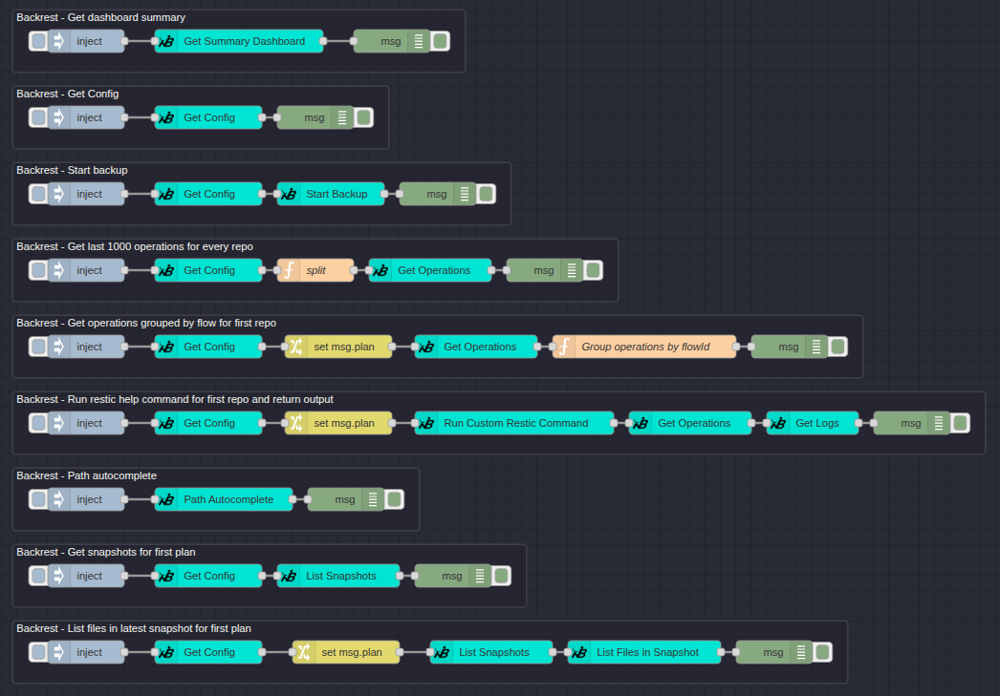

Examples
---

Each file shows one node. Import them from the Node-RED menu under **Import > Examples > @skylord123/node-red-contrib-backrest**, or copy a file's contents and paste it into **Import**. All examples share the same **Example** server config node: open it and enter your Backrest URL and login. Nodes that pick a plan, repository or operation from your server show the list once the server is set up.

### [Run Backup](Run%20Backup.json)

Back up a plan and report the result, a dry run with the plan taken from the message, and a nightly backup that sends an alert when it fails.

### [Backup Status](Backup%20Status.json)

Check every hour and alert only when a plan needs attention, the status of one plan, and every repository as one list.

### [Operation Events](Operation%20Events.json)

Every finished backup, the status changes of one plan, live backup progress, and subscribing on demand to Backrest's raw events.

### [Get Logs](Get%20Logs.json)

The log of an operation picked in the editor, the output of a restic command run through the API node, and the log of a backup after it finishes.

### [API](API.json)

Calls to many API endpoints: the config, the dashboard summary, operations, snapshots and their files, path autocomplete, and running a restic command.

